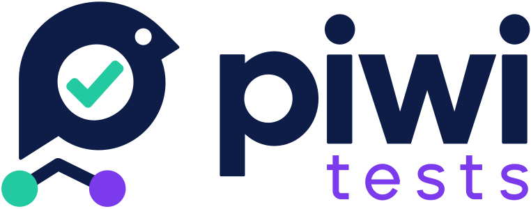
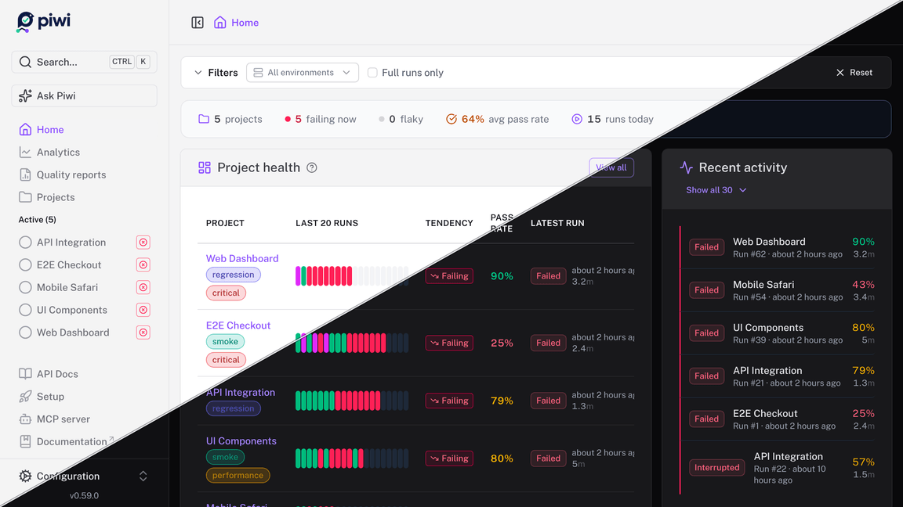
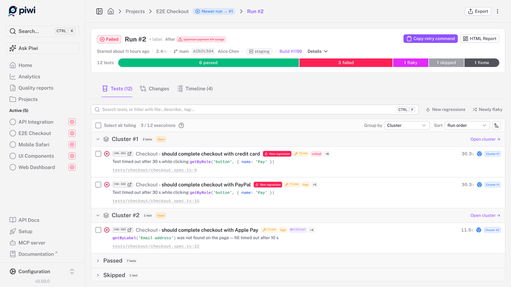
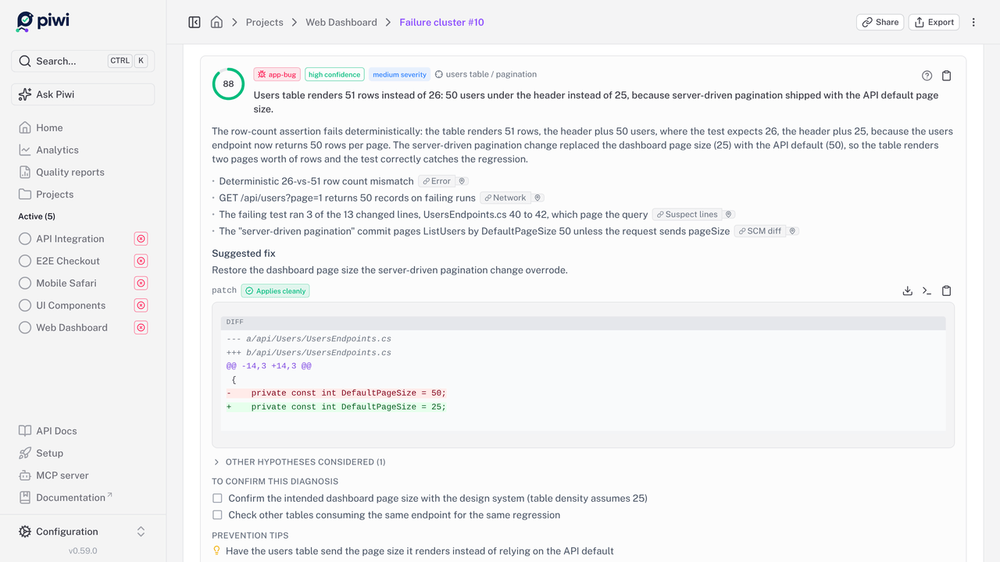
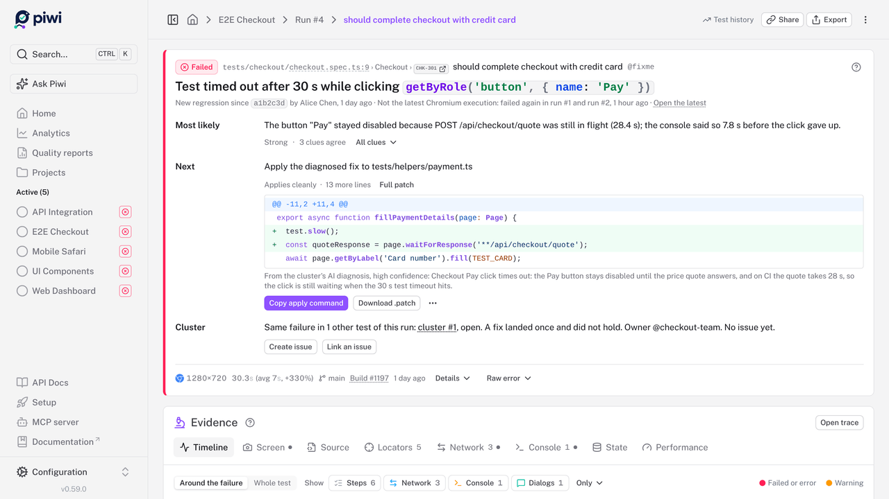
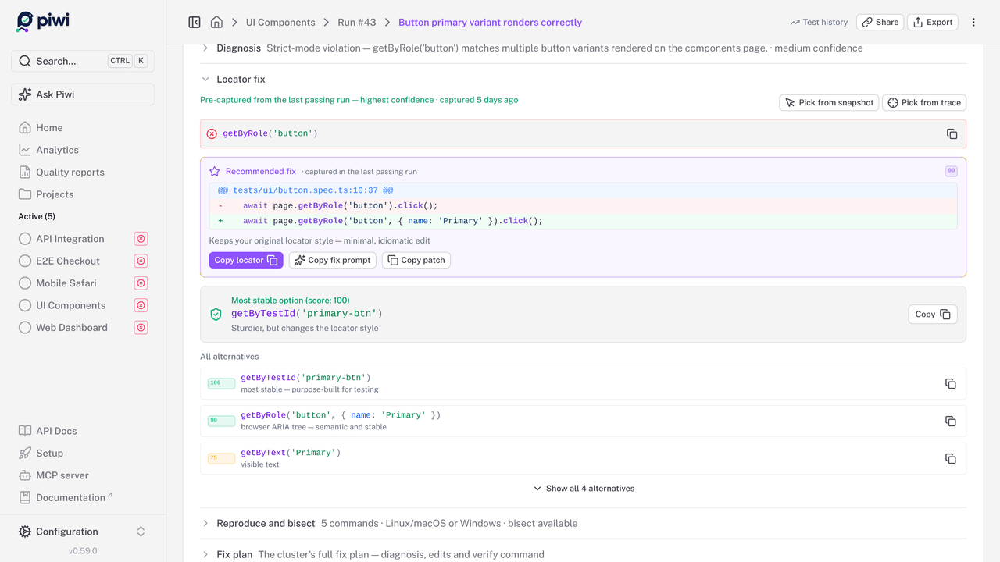
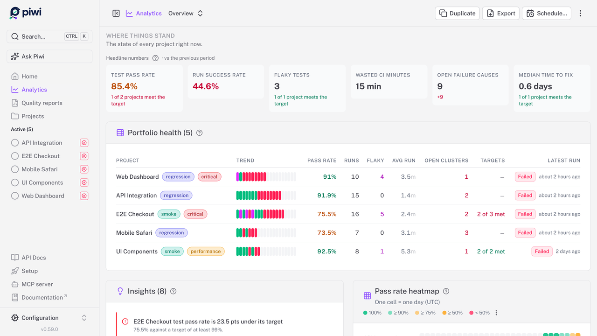
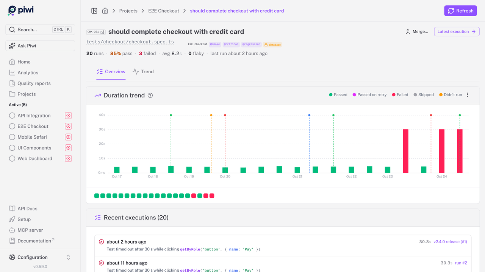
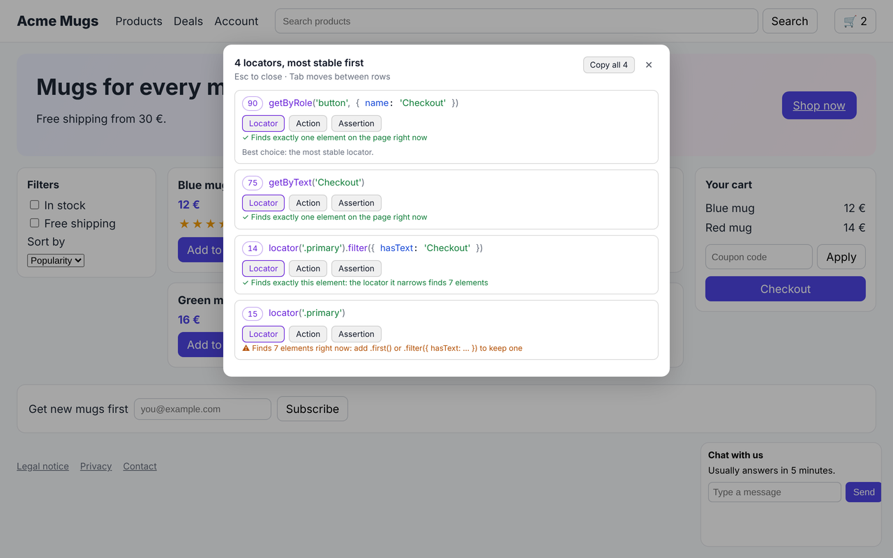
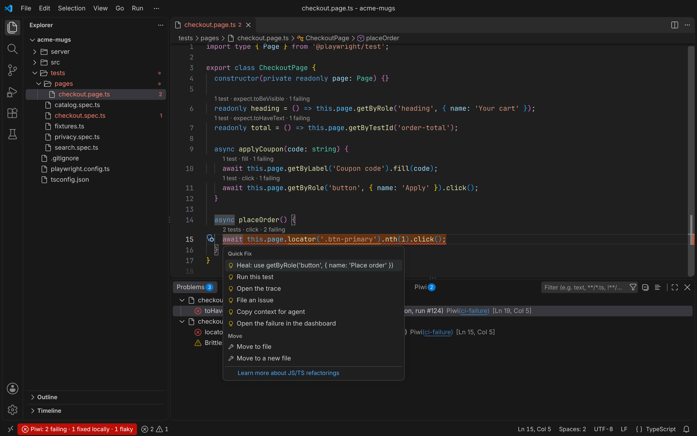

<p align="center">
  <picture>
    <source media="(prefers-color-scheme: dark)" srcset="./apps/docs/public/logo-wide-dark.svg">
    
  </picture>
</p>

<p align="center">
  <b>Your Playwright results, kept and explained.</b><br>
  CI throws away every report it makes. Piwi keeps them, then groups the failures by root cause,
  scores the flaky tests, and finds the locator you should have used. Self-hosted, zero telemetry.
</p>

<p align="center">
  <a href="https://piwitests.dev/demo/">Live demo</a> ·
  <a href="https://piwitests.dev">Documentation</a> ·
  <a href="https://piwitests.dev/guide/getting-started">Getting started</a> ·
  <a href="./ROADMAP.md">Roadmap</a> ·
  <a href="https://github.com/PiwiTests/piwi/discussions">Discussions</a>
</p>

<p align="center">
  <a href="https://www.npmjs.com/package/@piwitests/reporter"></a>
  <a href="https://www.npmjs.com/package/@piwitests/server"></a>
  <a href="https://hub.docker.com/r/phenx/piwitests-server"></a>
  <a href="https://github.com/PiwiTests/piwi/actions/workflows/ci.yml"></a>
  <a href="./LICENSE"></a>
</p>

<p align="center">
  <a href="https://piwitests.dev/demo/">
    
  </a>
</p>

<p align="center">
  <sub>The <a href="https://piwitests.dev/demo/">live demo</a> is the real app on seeded data. It runs entirely in your browser: nothing to install, no backend.</sub>
</p>

## Why

Playwright's HTML report is excellent, and it lasts exactly until the next build. The questions that
matter come later: *Has this test always been flaky? Did my fix hold? Which of these forty red tests
are the same bug?* Piwi keeps the runs so you can answer them. Everything it does serves four jobs:

1. **Keep the history.** Every run, trace and report, browsable long after CI deleted its artifacts.
2. **Explain the failures.** An error fingerprint collapses forty red tests into the three root causes
   behind them, each triaged once. Every flaky test gets a score, a root-cause class and the CI minutes
   it wastes, so you fix the expensive ones first.
3. **Hand back a fix.** When a locator breaks, ranked replacements captured from the last passing run,
   with the patch to apply. If you want it, an LLM *you* configure explains a cluster against your
   actual git diff, and its patch is checked against your source before you see it. Off by default.
4. **Find what your tests miss.** The routes, pages and controls no test reaches, from the runs you
   already have, each with a skeleton to start the missing test from.

Around them: live run streaming, cross-project analytics and scheduled quality reports, notifications
(email, Slack, Teams, webhooks), a REST API with in-app OpenAPI docs, and an MCP server so your coding
agent can ask about test health. [What Piwi does](https://piwitests.dev/guide/what-piwi-does) has the
whole picture; [All features](https://piwitests.dev/reference/features) lists each one with what it needs.

## See it

| | |
|---|---|
| [](https://piwitests.dev/features/failure-clusters) | [](https://piwitests.dev/features/ai-diagnosis) |
| **Failure clusters**: the red tests of a run grouped by root cause, each triaged once | **AI diagnosis**: read against your git diff, its patch checked against your source |
| [](https://piwitests.dev/features/evidence) | [](https://piwitests.dev/features/locator-healing) |
| **Failing execution**: what broke, the likely cause and the next step, above the evidence | **Locator healing**: replacements from the last passing run, and the patch to apply |
| [](https://piwitests.dev/features/analytics) | [](https://piwitests.dev/features/evidence#the-test-case-page) |
| **Analytics**: pass rate, flaky tests and wasted CI minutes across projects | **Test history**: every execution of a test, long after CI deleted its artifacts |

## In your browser and your editor

The same engine that scores locators in the dashboard works where you write the tests.

| | |
|---|---|
| [](https://piwitests.dev/features/extension) | [](https://piwitests.dev/features/editors) |
| **Piwi Picker**, the browser extension: ranked, stable locators picked from the page you are on, a flow recorded into a spec, a bug reproduced into a failing test. Standalone, nothing sent anywhere. | **VS Code and the JetBrains IDEs**: the latest CI failures at their lines, the heal as a quick fix, the tests behind each locator and file, and tests recorded at the cursor. |

## Start in three steps

**1. Run the dashboard.** With Docker:

```bash
# Linux / macOS
mkdir -p .data && sudo chown -R 1001:1001 .data # the container runs as non-root UID 1001
docker run -p 127.0.0.1:3000:3000 -v $(pwd)/.data:/app/.data phenx/piwitests-server:latest
```

```powershell
# Windows (PowerShell)
docker run -p 127.0.0.1:3000:3000 -v ${PWD}/.data:/app/.data phenx/piwitests-server:latest
```

It answers at `http://localhost:3000`, on this machine only: with authentication off, anyone who
reaches the port is an administrator, so publish it on every interface (`-p 3000:3000`) only once
[authentication](https://piwitests.dev/operate/authentication) is on. The SQLite database and the
`.data/` storage are created on the first request. On a Linux host, the `chown` matters: without it,
Docker creates `.data` owned by `root` and the container cannot write to it
([details](https://piwitests.dev/operate/deployment#permission-issues-with-volumes)).

Not a Docker person? Four other ways in:

| Path | Start here if | What it costs |
|---|---|---|
| **[Live demo](https://piwitests.dev/demo/)** | You want to look around first | Nothing: seeded data, entirely in your browser |
| **[Desktop app](https://piwitests.dev/features/desktop)** | You run Playwright locally and want no server at all | An installer; no Docker, no Node |
| **`npx @piwitests/server`** | You have Node.js 22+ and would rather skip Docker | One command, `.data/` in the current directory |
| **[One-click deploy](https://piwitests.dev/operate/deployment#one-click-deploy)** | You want a shared instance and no server to run it on | A button, plus what the host charges |

The desktop installers are not yet code-signed, so the first launch needs a click-through; they exist
for Windows x64, Apple-silicon macOS and Linux x86-64. The one-click templates ([`render.yaml`](./render.yaml),
[`fly.toml`](./fly.toml), [`deploy/`](./deploy)) are generated from the same variable registry as the
configuration reference, so they cannot drift from what the app reads; per-provider limits are in the
[deployment guide](https://piwitests.dev/operate/deployment#one-click-deploy).

**2. Connect your suite.** From your Playwright project:

```bash
npx @piwitests/reporter init --server-url http://localhost:3000 --project my-project
```

`init` installs the reporter, wraps your `playwright.config`, adds the capture fixtures and records the
connection in `.env.example`. Every step is safe to re-run, and a config shape it will not rewrite is
reported as a manual step with the exact change to make
([details](https://piwitests.dev/guide/getting-started#fast-path-one-command)). By hand, it is one
reporter entry and one fixtures file:

```typescript
// playwright.config.ts
import { defineConfig } from '@playwright/test'

export default defineConfig({
  reporter: [
    ['list'],
    ['@piwitests/reporter', {
      serverUrl: 'http://localhost:3000',
      projectName: 'my-project',
    }],
  ],
  use: { trace: 'retain-on-failure', screenshot: 'only-on-failure' },
})
```

```typescript
// tests/fixtures.ts
import { test as base, expect } from '@playwright/test'
import { piwiFixtures } from '@piwitests/reporter'

export const test = base.extend(piwiFixtures)
export { expect }
```

Import `test` from that file instead of `@playwright/test`, and the deeper features light up: locator
healing, slow-endpoint analysis, Web Vitals, console capture, failure-time ARIA snapshots
([capture fixtures](https://piwitests.dev/guide/capture-fixtures)). A runnable project lives in
[`examples/sample-app`](./examples/sample-app).

**3. Run your tests.** `npx playwright test`: the run streams into the dashboard while it executes,
the project is created on first submission, and the reporter prints a `View run:` link at the end. In
CI, set `PIWI_DASHBOARD_URL` (and `PIWI_API_KEY` once authentication is on): branch, commit, CI metadata
and `--shard` merging are detected automatically ([CI & sharding](https://piwitests.dev/guide/ci)).

Piwi is one Node process: about 300 MB of RAM idle, 1 vCPU, `linux/amd64` or `linux/arm64`. Disk is the
variable, as traces and reports dominate: budget 50 to 200 MB per run and set a retention window. Your
test project only needs a Node version Playwright supports; Node 22 is the *dashboard's* requirement.

## Before you expose it

The command above gives you an open dashboard with authentication off, which is fine on localhost and
not fine on a network. Three things to set before anyone else can reach it:

- `PIWI_AUTH_ENABLED=true` and `PIWI_AUTH_SECRET`, which turn on accounts and roles
  ([authentication](https://piwitests.dev/operate/authentication));
- `PIWI_SECRET_KEY`, the key stored credentials (AI keys, SCM tokens) are encrypted with: without it,
  the dashboard refuses to save them;
- HTTPS, through a reverse proxy ([deployment guide](https://piwitests.dev/operate/deployment#reverse-proxy-https)).

Generate a value for either secret with
`node -e "console.log(require('node:crypto').randomBytes(32).toString('hex'))"`. The full list, with
the trust-proxy flag, backups and version pinning, is the
[production checklist](https://piwitests.dev/operate/production-checklist). Found a vulnerability?
Please report it privately through the [security policy](./SECURITY.md).

## Where this fits

Playwright's own HTML report is the right tool for debugging a run on your machine; Piwi is for the runs
you cannot open anymore. It is deliberately **Playwright-only**: that is what makes traces, step timing
and locator healing first-class rather than lowest-common-denominator. If you need one place for JUnit,
pytest and Cypress results too, [ReportPortal](https://reportportal.io) or
[Allure](https://allurereport.org) fit better. If you would rather someone else ran the server,
[Currents](https://currents.dev) is the managed option. And if you only ever debug locally and never
look back, you do not need any of this. The longer version, including where Piwi loses, is
[Why Piwi?](https://piwitests.dev/guide/comparison).

## Published artifacts

Everything below is built and published from this repository on each release.

| Artifact | Registry | What it is |
|---|---|---|
| [`@piwitests/reporter`](https://www.npmjs.com/package/@piwitests/reporter) | npm | The Playwright reporter: add it to `playwright.config.ts` |
| [`@piwitests/server`](https://www.npmjs.com/package/@piwitests/server) | npm | The dashboard server, runnable with `npx @piwitests/server` |
| [`phenx/piwitests-server`](https://hub.docker.com/r/phenx/piwitests-server) | Docker Hub | The server container (`linux/amd64`, `linux/arm64`) |
| [`ghcr.io/piwitests/platform`](https://github.com/PiwiTests/piwi/pkgs/container/platform) | GHCR | The same container, mirrored, plus an `edge` tag built from `main` |
| Desktop app (`.msi`/`.exe`, `.dmg`, `.deb`/`.rpm`/`.AppImage`) | [GitHub Releases](https://github.com/PiwiTests/piwi/releases/latest) | The server bundled in a native window: no Docker, no Node |
| [Piwi Picker](https://chromewebstore.google.com/detail/piwi-picker/pakhnokpjboejcghgcmkjlpnogfjihhe) | Chrome Web Store | The browser extension, for Chrome, Edge and the other Chromium browsers |
| [Piwi Picker](https://addons.mozilla.org/firefox/addon/piwi-picker/) | Firefox Add-ons | The same extension, for Firefox |
| [Piwi for VS Code](https://marketplace.visualstudio.com/items?itemName=PiwiTests.piwi) | Visual Studio Marketplace, [Open VSX](https://open-vsx.org/extension/piwitests/piwi) | The VS Code extension (Cursor and VSCodium too) |
| [Piwi for JetBrains IDEs](https://plugins.jetbrains.com/plugin/34674-piwi) | JetBrains Marketplace | The IDE plugin (WebStorm, IntelliJ IDEA Ultimate, Rider, from 2024.1) |
| [`@piwitests/instrumentation-nitro`](https://www.npmjs.com/package/@piwitests/instrumentation-nitro) | npm | Optional: sends your Nitro/Nuxt backend's logs into a test run |
| [`PiwiTests.Instrumentation.AspNetCore`](https://www.nuget.org/packages/PiwiTests.Instrumentation.AspNetCore) | NuGet | Optional: the same for an ASP.NET Core backend |
| [`PiwiTests.Instrumentation.Serilog`](https://www.nuget.org/packages/PiwiTests.Instrumentation.Serilog) | NuGet | Optional: a Serilog sink for an ASP.NET Core backend that logs through Serilog |
| [`PiwiTests.Instrumentation.Core`](https://www.nuget.org/packages/PiwiTests.Instrumentation.Core) | NuGet | The capture buffer the two .NET packages above share, installed with them |

The instrumentation packages are only needed for [backend log capture](https://piwitests.dev/guide/backend-logs).
Both container registries carry the same images. The browser extension and the editor extensions
reach their stores through each store's review, so a listed version can trail a release by a day or two.

## Project status

Pre-1.0 and under active development: expect occasional breaking changes between minor versions, pin a
version tag, and keep backups of `.data/`. Every commit runs a CI matrix across SQLite/PostgreSQL and
local/S3 storage with a full Playwright E2E suite.

Upgrades apply database migrations automatically on startup, and those migrations are **forward-only**:
rolling back means restoring a backup, not pulling the old tag. Read
[Upgrading](https://piwitests.dev/operate/upgrading) before your first version bump. Direction and
non-goals live in the [roadmap](./ROADMAP.md).

## Documentation

Full docs at **[piwitests.dev](https://piwitests.dev)**. The usual entry points:

- [Getting started](https://piwitests.dev/guide/getting-started): install, reporter, first run
- [Your first failure, explained](https://piwitests.dev/guide/first-failure): one failing test, from its headline to its evidence
- [Core concepts](https://piwitests.dev/guide/concepts): runs, test cases, executions, clusters
- [Reporter](https://piwitests.dev/guide/reporter) and [CI & sharding](https://piwitests.dev/guide/ci): getting results in
- [Deployment](https://piwitests.dev/operate/deployment) and [Configuration](https://piwitests.dev/reference/configuration): running your instance
- [Upgrading](https://piwitests.dev/operate/upgrading): what a version bump does, and why downgrading is not a thing
- [Privacy & data flow](https://piwitests.dev/guide/privacy): exactly what leaves your server, which is nothing you did not configure
- [Browser extension](https://piwitests.dev/features/extension) and [Editor extensions](https://piwitests.dev/features/editors): Piwi where you write the tests
- [MCP server](https://piwitests.dev/features/mcp) and [Agent skills](https://piwitests.dev/features/agent-skills): Piwi for your coding agent

A running dashboard also serves interactive API docs at `/docs`, rendered in-app from its own OpenAPI
spec, with no external CDN, so they work offline.

## Community & support

- 💬 [Discussions](https://github.com/PiwiTests/piwi/discussions): questions, ideas, show & tell
- 🐛 [Issues](https://github.com/PiwiTests/piwi/issues): bugs and feature requests
- 🔐 [Security policy](./SECURITY.md): how to report a vulnerability

## Contributing

Contributions are welcome: [CONTRIBUTING.md](CONTRIBUTING.md) covers dev setup, tests and commit
conventions, and [AGENTS.md](AGENTS.md) has the architecture tour.

```bash
cd apps/application && npm install && npm run app:dev   # http://localhost:3000
```

## License

Fair source. The dashboard, the server, the desktop app, the browser extension and the editor
extensions are under the [Functional Source License, Version 1.1, MIT Future License](LICENSE)
(FSL-1.1-MIT): use it, self-host it and modify it for free, at work too. What it rules out is offering
Piwi, or a product built from it, as a commercial product or service that competes with it. Each release
becomes MIT two years after it is published.

The reporter, the integrations and the examples are MIT. Releases up to v0.39.x stay MIT.
See [License](https://piwitests.dev/guide/license) for what is and is not allowed.

---

<sub>**Disclaimer:** Piwi Dashboard is **not affiliated with, endorsed by, or connected to Microsoft Corporation** in any way. "Piwi" is a playful, unrelated name with no connection to any existing product or brand. Playwright is a trademark of Microsoft Corporation.</sub>
